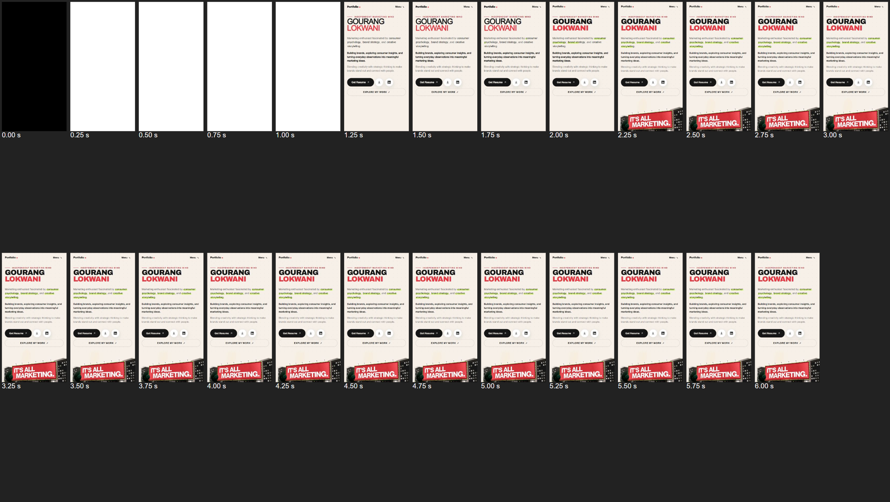
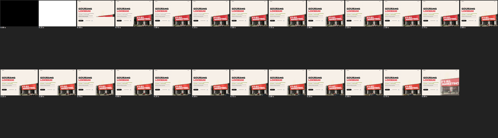

# First load — after (live site, commit `13425a7`)

Same tools and conditions as [`first-load-before.md`](first-load-before.md): Lighthouse
(simulated Slow 4G + CPU ×4 for mobile, desktop preset) and `scripts/first-load-probe.mjs`
(Playwright + Chrome 155, Moto G viewport, Slow 4G via CDP, CPU ×4, 250 ms film strip).

## Before / after

### Lighthouse — live, mobile (3 runs after; median in bold)

| | Before | After | Target |
| --- | --- | --- | --- |
| Performance | 98 | 100 / 98 / **99** | ≥ 90 ✅ |
| FCP | 1.7 s | 1.1 / 1.6 / **1.4 s** | ≤ 1.2 s ⚠️ (1 of 3 runs) |
| LCP | 2.1 s | 1.5 / 2.1 / **2.0 s** | ≤ 2.0 s ✅ (median) |
| TBT | 10 ms | **0 ms** | ≤ 150 ms ✅ |
| CLS | 0 | **0** | ≤ 0.02 ✅ |
| Speed Index | 1.7 s | 1.9 / 1.6 / **1.6 s** | ≤ 2.5 s ✅ |
| Time to Interactive | 2.4 s | **2.0 s** | — |

### Lighthouse — live, desktop

| | Before | After |
| --- | --- | --- |
| Performance | 86 | **100** (×2) |
| FCP / LCP | 0.5 s / 0.7 s | **0.3–0.4 s / 0.4–0.5 s** |
| TBT | **310 ms** | **0 ms** |
| CLS | 0 | 0.004 |
| TTI | 1.2 s | **0.4–0.5 s** |

### Real trace — live, mobile (Slow 4G + CPU ×4)

| | Before | After |
| --- | --- | --- |
| First paint | 2.85 s | **1.09 s** |
| LCP (hero poster) | 2.85 s | **2.11 s** (1.89 s on the preview build) |
| Bytes / requests needed for first paint | 186 kB / 6 | **8 kB / 1** (the HTML) |
| Bytes by `load` | 186 kB | 245 kB (11 requests) |
| Bytes in 6 s | 376 kB (24 req) | 390 kB (32 req) |
| Long tasks > 50 ms in 6 s | 7 (worst 281 ms) | **2** — 222 ms before first paint ¹, 56 ms (React) |
| Sections mounting | all 5 at once, 4.0–5.0 s | one at a time, ~3.5–7 s |
| CLS | 0 | 0 |

### Real trace — live, desktop

| | Before | After |
| --- | --- | --- |
| First paint / LCP | 0.43 s / 0.43 s | **0.34 s / 0.65 s** |
| three.js requested at | 0.30 s | after 5 s |
| Long tasks in the first 5 s | 6 (187, **280**, 89 ms … from three.js) | **0** |
| Long tasks when the 3D starts (~5.6 s) | — | 64 ms, 75 ms |

Console errors / warnings / failed requests: **0** everywhere. That covers both traces, all
Lighthouse runs, and the live sweep: 1440×900, 1280×720, iPhone 13 and 360×740, in normal and
reduced motion.

¹ The very first layout of any page costs ~150 ms at ×4 CPU on this test machine, even with no web
fonts at all (Windows' text system warming up). The web fonts and size-matched fallbacks add ~70 ms.
It happens **before** first paint, so it doesn't count towards TBT and nothing can be interacted
with yet; on desktop without throttling it is 48 ms.

## Film strips (every 250 ms)

**Before — mobile:** white until 2.0 s, an empty ivory page until 2.75 s, then the hero with a
fading headline at 3.0 s.

**After — mobile:** the whole first screen (top bar, headline, copy, buttons) appears at once at
1.25 s. The headline is in its size-matched fallback until Archivo 900 arrives (~2.0 s, no
shift), and the poster lands at 2.25 s. No freezes, no half-loaded frames, nothing popping in.

## What changed

1. **Static first screen.** At build time the top bar and the hero are rendered to HTML
   (`src/shell/entry-shell.tsx` → `scripts/prerender-shell.mjs`) and put into `index.html`, with
   the critical CSS (beasties) and every `@font-face` inlined. The full stylesheet loads without
   blocking. The first screen therefore paints from 8 kB of HTML. React renders the real page
   underneath, and once its hero poster is on screen the static copy is removed. Both are
   identical: the headline doesn't replay its entrance, and the lime highlights continue in step.
2. **Poster first.** The poster is preloaded and is the `` of a media-aware `<picture>`. The
   app's JavaScript starts downloading once the poster has loaded (2.5 s at the latest), so the LCP
   image isn't competing with ~90 kB of JS on a slow link.
3. **One section at a time** (`lib/sectionQueue.ts`). Capabilities is now lazy too. Sections mount
   in page order, the next only after the previous has mounted and the browser is idle. A section
   within 1000 px of the viewport loads immediately. Skeletons use each section's measured height
   per breakpoint, so the page height doesn't jump.
4. **Heavy work never in the first frames** (`lib/settle.ts`):
   - The hero video waits for `load` + 1.5 s + idle.
   - The live 3D hero and the solar system start no earlier than 5 s, after that, and one after
     the other.
   - The 3D libraries load in idle-time steps (`lib/load3d.ts`).
   - The hero scene builds a piece per frame, compiles its shaders in parallel and reads their
     uniforms in 10 ms slices, then uploads meshes group by group (lights untouched, so no shader
     recompiles).
   - Car geometry is built once per shape, not per car.
   - The Real Me web is built only when the section is near.
   - No forced layout in the first render (`matchMedia` instead of `innerWidth`).
5. **Smaller first download.** Vendor chunks: React, motion, three, R3F. Initial JS is 90 kB gzip
   (19 app + 47 React + 25 motion), CSS 16 kB, initial transfer 245 kB, and three/R3F/drei/pdf.js
   stay lazy. Only Archivo 900 is preloaded.
6. **Caching.** Hashed assets and fonts are `immutable`. HTML is revalidated by the browser and
   served stale-while-revalidate at Vercel's edge (brotli confirmed).
7. **Gate.** `npm run check` now opens the page untouched on desktop and on a phone, and fails on
   any task over 100 ms in the first 5 s, any console error or warning, or any failed request.
   This runs alongside the full interaction tour, landscape and small-phone tests.

## Missed or partly met (with reasons)

- **Lighthouse mobile FCP 1.4 s median (1.1 s best) against ≤ 1.2 s.** Lighthouse simulates this
  value from a fast unthrottled run, and it counts the poster and font downloads that start before
  first paint as part of the critical path, though the static first screen needs neither. The real
  throttled trace on the live site paints at **1.09 s**. Run-to-run network variance moves this
  figure by ±0.3 s.
- **Real-trace LCP 2.11 s against ≤ 2.0 s** (Lighthouse median 2.0 s, preview build 1.89 s). The
  poster (40 kB) and the hero's fonts share a 1.47 Mbps link. An AVIF poster (roughly 25 kB) would
  give a further margin; it needs an AVIF encoder, which isn't set up here.
- **The 222 ms pre-paint layout** in the ×4-CPU trace (see ¹). It's this machine's first-layout cost,
  identical in the before build, and it isn't counted by TBT.
- **Not done (optional):** a service worker for instant repeat visits. Repeat visits already load
  every hashed file from the browser cache (`immutable`). The branded intro wasn't added, as you
  asked.
