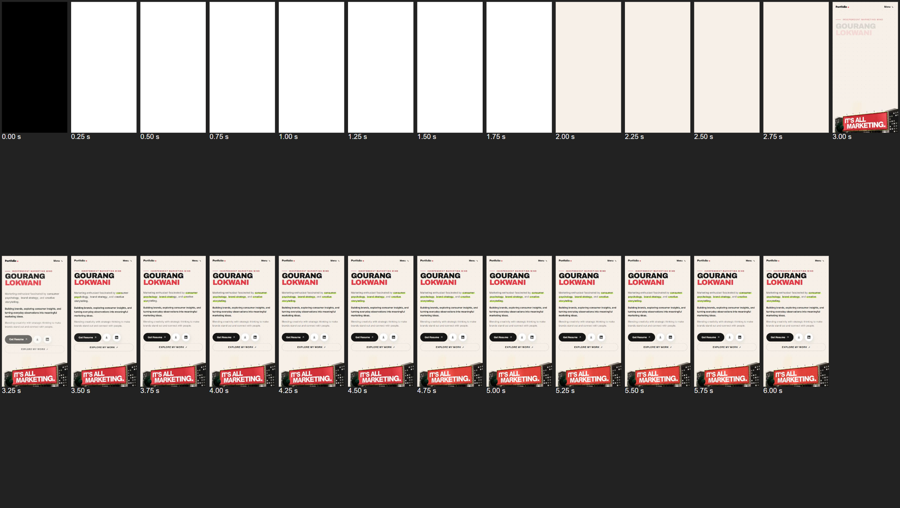
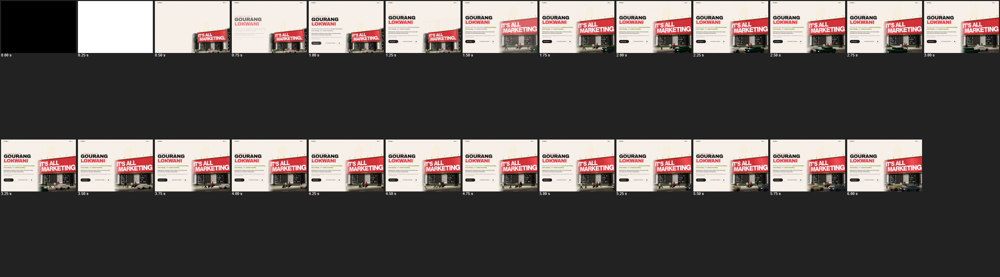

# First load — before (live site, commit `6e0a16c`)

Tools: Lighthouse 12 (simulated Slow 4G + CPU ×4 for mobile, desktop preset), and
`scripts/first-load-probe.mjs`: Playwright + Chrome 155, Moto G Power viewport (412×823 @1.75),
**Slow 4G applied via CDP (562.5 ms RTT, 1.47 Mbps down) + CPU ×4**, a 6–9 s trace with screenshots,
long tasks attributed to their scripts, and bytes counted per request.

## Lighthouse

| Run | Perf | FCP | LCP | TBT | CLS | Speed Index | TTI |
| --- | --- | --- | --- | --- | --- | --- | --- |
| Live, mobile (×2, identical) | 98 | 1.7 s | 2.1 s | 10 ms | 0 | 1.7 s | 2.4 s |
| Live, desktop | **86** | 0.5 s | 0.7 s | **310 ms** | 0 | 0.9 s | 1.2 s |
| Preview build, mobile | 94 | 2.2 s | 2.7 s | 10 ms | 0 | 2.2 s | 3.1 s |
| Preview build, desktop | 88 | 0.6 s | 0.8 s | 280 ms | 0 | 0.8 s | 1.4 s |

## Trace — live, mobile (Slow 4G, CPU ×4)

- **First paint at 2.85 s.** The HTML is an empty `
`, so nothing can paint until
  the 92 kB app bundle has downloaded and run. Film strip: white until 2.0 s, an empty ivory page
  2.0–2.75 s, then the hero appears at 3.0 s, with the headline still fading in.
- **LCP 2.85 s** (the hero poster), CLS 0. 186 kB in 6 requests before first paint.
- **All five lazy sections download at the same moment** (~2.9 s) and mount together between 4.0
  and 5.0 s.
- Long tasks over 50 ms:

| At | Duration | Source |
| --- | --- | --- |
| 2.36 s | 72 ms | app bundle |
| 2.44 s | 81 ms | app bundle (React's first render) |
| **2.52 s** | **281 ms** | **layout 242 ms** — the first layout of the whole initial page |
| 4.01 s | 68 ms | layout of mounting sections |
| 4.13 s | 54 ms | layout of mounting sections |
| **4.28 s** | **128 ms** | sections mounting (React 127 ms) |
| 4.95 s | 53 ms | sections mounting |

## Trace — live, desktop

- First paint / LCP 0.43 s, but **the three.js chunk (221 kB) starts downloading at 0.30 s**: the
  live 3D hero starts as soon as WebGL is confirmed.
- Long tasks: 64 ms (layout), 67 ms (React), **187 ms + 280 ms + 89 ms (three.js / R3F: building
  the scene, then compiling shaders on first use)**, 59 ms. Everything happens in the first 1.3 s.
- 484 kB before first paint, 681 kB in 29 requests within 6 s.

## What loads when (before)

- **Immediately:** `index.js` (92 kB brotli: React, framer-motion, the shell, the hero and the
  Capabilities section), CSS 16 kB, the hero poster, Archivo 900 and Inter 400 (preloaded).
- **Lazy:** the five other sections (all requested together after first paint), the solar
  system, the hero scene + three/R3F/drei (221 kB, requested at once on desktop) and pdf.js (116 kB,
  only when a certificate opens).

## Console

0 errors, 0 warnings, 0 failed requests (mobile and desktop).

## Causes

1. **Client-rendered first screen:** blank until JS runs.
2. **Burst mount:** every lazy section mounts in the same idle callback, so the rest of the page
   pops in together, with long tasks.
3. **3D on the first frames (desktop):** the three.js evaluation, scene build and first-use shader
   compile all land in the first second.
4. Section placeholders were a fixed 100svh, not the real heights.
